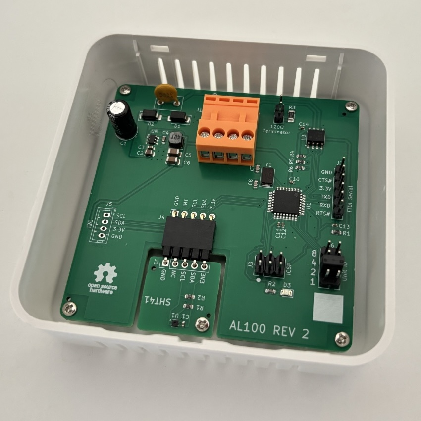

AL100 Modbus Room Sensor
========================

<a href="docs/al100-rev2-photo.jpg"></a>

[](https://github.com/njh/modbus-room-sensor/releases/latest)
[](LICENSE.md)
[](https://www.oshwa.org/definition/)

A temperature and humidity room sensor board for building automation. It is a Modbus RTU
server on RS-485, runs from 5–24 V DC, and fits in a standard wall-mounted room
sensor enclosure.

It uses a I²C sensor on a separate 19x19mm board, which is compatible with some of the
[Pimoroni Breakout Sensor Boards], so it is possible to use alternative sensors with it.

It is open source hardware and software: the KiCad design files, schematics,
Gerbers, bootloader and documentation are all MIT licensed, so you can build and
modify your own.

The board is Arduino compatible: it is designed to be very similar to the 3.3 V
[Arduino Pro Mini], so it can be programmed with the same settings.


Features
--------

- Sensirion [SHT4x] temperature and humidity sensor, on a swappable plug-in module
- Modbus RTU over half-duplex RS-485, with a ±70 V fault-protected transceiver
- Unit ID from 1 to 15, set with jumpers
- Jumper to enable the 120 Ω bus terminator
- 5–24 V DC supply, with a resettable fuse, reverse-polarity and surge protection
- Power and RS-485 on one 4-way HT396 connector, with the same pinout as M5Stack's [PWR485]
- Spare I²C socket for adding another sensor
- Fits the [Camdenboss CBRS01VWH] "Size 1" vented room sensor enclosure
- Designed in [KiCad], and assembled by JLCPCB


Downloads
---------

Schematics and Gerber files are built by GitHub Actions on every push to `main`,
and published as a [GitHub release][latest release]. These links always point to
the latest release:

| File                                       | Description                              |
|--------------------------------------------|------------------------------------------|
| [modbus-room-sensor-schematic.pdf]         | Main board schematic                     |
| [modbus-room-sensor-gerbers.zip]           | Main board Gerber and drill files        |
| [sht4x-breakout-schematic.pdf]             | SHT4x breakout board schematic           |
| [sht4x-breakout-gerbers.zip]               | SHT4x breakout board Gerber and drill files |


Specifications
--------------

| Item             | Value                                            |
|------------------|--------------------------------------------------|
| Supply voltage   | 5-24 V DC                                        |
| Interface        | RS-485, half-duplex                              |
| Protocol         | Modbus RTU, 9600 baud, 8N1                       |
| Unit ID          | 1-15, set by jumpers (default 1)                 |
| Sensor           | Sensirion SHT41: typically ±0.2 °C and ±1.8 %RH  |
| Resolution       | 0.1 °C and 0.1 %RH                               |
| Update interval  | 2 seconds                                        |
| Main board       | 73.3 x 73.3 mm, 2 layers                         |
| Enclosure        | [Camdenboss CBRS01VWH], 86 x 86 mm               |


Hardware
--------

### Main components

| Ref | Function             | Part                         |
|-----|----------------------|------------------------------|
| U1  | Microcontroller      | [ATmega328P] (3.3 V, 8 MHz)  |
| U3  | RS-485 transceiver   | [THVD2410]                   |
| U5  | 3.3 V buck converter | [AP63203]                    |
|     | Sensor               | [SHT4x], on the [SHT4x breakout board](sht4x-breakout/) |

### Connectors and jumpers

| Ref | Name         | Description |
|-----|--------------|-------------|
| J1  | Terminal     | 4-way 3.96 mm HT396 socket: `GND`, `VIN`, `A+`, `B-`. The same pinout as M5Stack's [PWR485], so it can share a 9–24 V supply and RS-485 bus with M5Stack devices |
| J2  | FTDI Serial  | 6-pin header for a 3.3 V FTDI cable, for uploading firmware and the debug console |
| J3  | ICSP         | 2x3 header for writing the bootloader |
| J4  | Sensor board | 5-way socket for the SHT4x breakout: `GND`, `INT`, `SCL`, `SDA`, `3.3V` |
| J5  | I2C          | 4-way JST PH socket: `SCL`, `SDA`, `3.3V`, `GND` (the same order as Grove and STEMMA) |
| J6  | Unit ID      | 2x4 header for the unit ID jumpers |
| JP1 | Terminate    | Fit a jumper to connect the 120 Ω terminator across A and B |

There are no I²C pull-up resistors on the main board. The SHT4x breakout has
4.7 kΩ pull-ups, so a sensor on J5 without the breakout needs its own.


Installation
------------

1. Set the unit ID by fitting jumpers on J6. The unit ID is the sum of the
   values printed next to the fitted jumpers (1, 2, 4 and 8), so fitting 1 and
   4 gives unit ID 5. With no jumpers fitted, the unit ID is 1. The jumpers are
   only read at power-up.
2. Connect the supply to `VIN` and `GND` on J1, and the RS-485 bus to `A+` and `B-`.
3. If the sensor is at one end of the bus, fit the `Terminate` jumper (JP1).
   Otherwise, leave it off.

Each device on the bus needs a unique unit ID.


Modbus Interface
----------------

The sensor board is a Modbus RTU server on RS-485 (J1), at 9600 baud, 8N1.

| Address  | Type                    | Name              | Format          | Units |
|----------|-------------------------|-------------------|-----------------|-------|
| `0x0001` | Input register (FC 04)  | Temperature       | Signed, x 10    | °C    |
| `0x0002` | Input register (FC 04)  | Relative humidity | Unsigned, x 10  | %RH   |

Addresses are the zero-based addresses sent on the bus. Tools that use
one-based 3xxxx numbering call these 30002 and 30003.

For example, `0x00EA` is 23.4 °C and `0xFFCB` is −5.3 °C. Both registers read
`0x8000` if the sensor couldn't be read.


### Reading the sensor

With a USB to RS-485 adapter, you can read the sensor using [modbus-cli]:

```sh
pip install modbus_cli
modbus -b 9600 -s 1 /dev/ttyUSB0 i@1/h i@2/H
```


Programming
-----------

The firmware is in [firmware/ModbusFirmware](firmware/ModbusFirmware). It needs
the [ModbusRTUSlave] and [Sensirion I2C SHT4x] libraries, which can be installed
with the Arduino IDE's Library Manager.

The board is programmed like a 3.3 V Arduino Pro Mini. In the Arduino IDE, choose
the **Arduino Pro or Pro Mini** board, with the **ATmega328P (3.3V, 8 MHz)**
processor option, and upload with a 3.3 V FTDI cable on J2.

A new board needs a bootloader before it can be programmed from the Arduino IDE.
See [bootloader/README.md](bootloader/README.md) for how to write it using ICSP.

Modbus doesn't work over the FTDI header, because the RS-485 receiver drives the
same RX line. Instead, at power-up the firmware prints when it was built, the unit
ID and the SHT4x serial number to the FTDI header, at 9600 baud.


ATmega328P pin mapping
----------------------

If you want to make your own software / firmware for the board, here is the
pin mapping for use in the Arduino IDE:

| Port | Arduino | Function                                |
|------|---------|-----------------------------------------|
| PD0  | D0      | UART RX, from RS-485 and FTDI           |
| PD1  | D1      | UART TX, to RS-485 and FTDI             |
| PD2  | D2      | RS-485 driver enable (DE)               |
| PD3  | D3      | RS-485 receiver enable (RE, active low) |
| PD4  | D4      | Sensor board interrupt                  |
| PD5  | D5      | _Unused_                                |
| PD6  | D6      | _Unused_                                |
| PD7  | D7      | _Unused_                                |
| PB0  | D8      | _Unused_                                |
| PB1  | D9      | _Unused_                                |
| PB2  | D10     | _Unused_                                |
| PB3  | D11     | ICSP MOSI                               |
| PB4  | D12     | ICSP MISO                               |
| PB5  | D13     | ICSP SCK and the Red LED                |
| PC0  | A0      | Unit ID jumper, value 1                 |
| PC1  | A1      | Unit ID jumper, value 2                 |
| PC2  | A2      | Unit ID jumper, value 4                 |
| PC3  | A3      | Unit ID jumper, value 8                 |
| PC4  | A4      | I²C data                                |
| PC5  | A5      | I²C clock                               |
| ADC6 | A6      | _Unused_                                |
| ADC7 | A7      | _Unused_                                |
| PC6  |         | Reset, from ICSP and FTDI auto-reset    |


Making a Board
--------------

The surface-mount parts are assembled by JLCPCB (Economic PCBA, top side only).
The LCSC part numbers are in the `LCSC` field of each part in the schematics.
In JLCPCB's placement preview, check the orientation of U1, U3, U5, D2 and D3.

The through-hole parts are fitted by hand. In soldering order:

| Ref | Part                                                    |
|-----|---------------------------------------------------------|
| J4  | 1x5 right-angle socket header, 2.54 mm                  |
| J5  | JST PH 4-way vertical socket (B4B-PH-K), optional       |
| F1  | Littelfuse RXEF050, 0.5 A resettable fuse               |
| J2  | 1x6 pin header, 2.54 mm                                 |
| J3  | 2x3 pin header, 2.54 mm                                 |
| J6  | 2x4 pin header, 2.54 mm, and jumpers                    |
| JP1 | 1x2 pin header, 2.54 mm, and a jumper                   |
| J1  | Kefa HT396R 4-way horizontal socket, 3.96 mm            |
| C1  | 47 µF 50 V electrolytic, 6.3 mm diameter, 2.5 mm pitch  |

You also need a [Camdenboss CBRS01VWH] enclosure, and 5 pan head M2.3 x 5 mm
self-tapping PCB screws.


License
-------

This project is open source hardware and software. The hardware design files,
software and documentation are all licensed under the terms of the MIT license.
See the file [LICENSE.md](LICENSE.md) for details.


[latest release]:  https://github.com/njh/modbus-room-sensor/releases/latest
[modbus-room-sensor-schematic.pdf]:  https://njh.github.io/modbus-room-sensor/modbus-room-sensor-schematic.pdf
[modbus-room-sensor-gerbers.zip]:    https://github.com/njh/modbus-room-sensor/releases/latest/download/modbus-room-sensor-gerbers.zip
[sht4x-breakout-schematic.pdf]:      https://njh.github.io/modbus-room-sensor/sht4x-breakout-schematic.pdf
[sht4x-breakout-gerbers.zip]:        https://github.com/njh/modbus-room-sensor/releases/latest/download/sht4x-breakout-gerbers.zip

[ATmega328P]:           https://www.microchip.com/en-us/product/atmega328p
[THVD2410]:             https://www.ti.com/product/THVD2410
[AP63203]:              https://www.diodes.com/part/view/AP63203
[SHT4x]:                https://sensirion.com/products/catalog/humidity-sensors?series=SHT4x
[KiCad]:                https://www.kicad.org/
[modbus-cli]:           https://github.com/favalex/modbus-cli
[ModbusRTUSlave]:       https://github.com/CMB27/ModbusRTUSlave
[Sensirion I2C SHT4x]:  https://github.com/Sensirion/arduino-i2c-sht4x

[Arduino Pro Mini]:                https://docs.arduino.cc/retired/boards/arduino-pro-mini/
[Camdenboss CBRS01VWH]:            https://www.camdenboss.com/ucommerce/cbrs01vwh-room-sensor-enclosure%2c-size-1%2c-vented%2c-white%2c-86x86x25.5mm/c-23/p-23038
[Pimoroni Breakout Sensor Boards]: https://shop.pimoroni.com/collections/breakouts?category=Sensors
[HT396]:                           https://www.kefaelectronic.com/HT396R-3-96-Pluggable-terminal-block-pd40161364.html
[PWR485]:                          https://docs.m5stack.com/en/stamp/Stamp_PWR485
